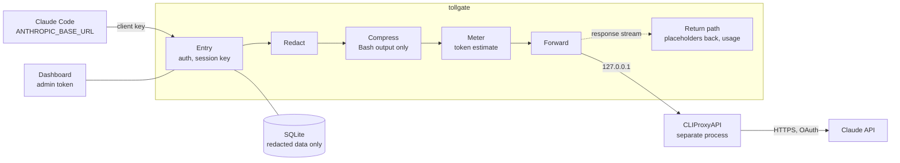

# tollgate

An auditable gateway for Claude API calls. Every request from Claude Code passes through
a fixed pipeline of redaction, compression, metering, and forwarding. Each stage records
what it changed, so you can inspect it afterwards.

Written in Go, with an embedded Svelte dashboard and SQLite storage. Licensed under MIT.

## Why a gateway in front of LLM calls

Coding agents send a lot of text to a model provider: file contents, shell output, logs,
connection strings, and whatever the developer pasted. Three problems follow.

- **Data protection.** Secrets, personal data, and customer names end up in prompts. Hooks
  on every client are easy to forget or bypass. A single gateway enforces the rule in one
  place, and clients only change a URL.
- **Cost.** Much of the volume is tool output (build logs, test runs, diffs, search
  results). Shortening it before it reaches the model saves tokens, but only if the
  result stays reproducible.
- **Audit.** Without a central record, nobody can say what left the machine, what it cost,
  or which subscription handled it.

tollgate sits between the client and the provider and addresses these three points
without any client-side tooling.

## What it does

| Stage | Behavior |
|---|---|
| Entry | Checks the client key before the body is read. Derives a session key from the client and `X-Claude-Code-Session-Id`. |
| Redact | Detects secrets and personal data and replaces them with numbered placeholders such as `<redacted:email_1>`. Built-in patterns cover Anthropic, OpenAI, AWS, GitHub, Slack, and Stripe keys, JWTs, PEM private keys, e-mail addresses, connection strings, IP addresses, auth headers, and generic assignments. Customer and word lists are configurable. |
| Compress | Shortens Bash `tool_result` blocks only: test logs, build logs, diffs, search output. File contents (Read, Edit, Write) are never touched. The strategies are Go ports of Headroom's deterministic compressors. |
| Meter | Estimates tokens before forwarding and records `usage` from the response stream. |
| Forward | Sends the result to CLIProxyAPI, which talks to Anthropic. |
| Return path | Translates placeholders back to the original values in the streamed response, so the client sees plain text. Thinking blocks and signatures are never modified. |

Design rules that the code and tests enforce (details in `docs/ARCHITECTURE.md`, section 6):

- All transformations are deterministic, byte for byte. The request body is never
  re-serialized; only target strings are spliced (ADR-0004). This keeps the provider's
  prompt cache valid.
- If a stage fails or the body is not valid JSON, the request is rejected. It is never
  forwarded unfiltered.
- The placeholder mapping lives in RAM only, for the duration of one request. Logs, the
  database, and the dashboard contain redacted data only.
- tollgate refuses to start on a wildcard address or outside the Tailscale ranges.
  CLIProxyAPI binds to loopback only.
- Account tokens and name lists are encrypted at rest with AES-256-GCM.

## Architecture



CLIProxyAPI runs as its own process. The container image builds it from a pinned upstream
commit; it is neither vendored nor imported (ADR-0001, ADR-0014). Its egress is restricted
to Anthropic's address ranges (ADR-0017).

The dashboard shows each request stage by stage (what was redacted or shortened), call
history, token and cost metering, subscription limits and capacity, and the redaction
configuration with versioning and dry run.

## Quickstart

Container deployment. Requirements: Docker with Compose v2, [just](https://just.systems),
curl, Tailscale on the host, and a Claude subscription for the OAuth login.

```sh
just setup            # checks prerequisites, creates secrets, builds, logs in, starts
just client laptop    # prints ANTHROPIC_BASE_URL and ANTHROPIC_AUTH_TOKEN for one client
```

Then, on the client:

```sh
export ANTHROPIC_BASE_URL=http://<tailnet-ip>:8443
export ANTHROPIC_AUTH_TOKEN=tg_...
claude
```

The dashboard is at `http://<tailnet-ip>:8443/`. The admin token is in `secrets/admin_token`.
`just smoke` builds and checks the stack without Tailscale. Full instructions:
[docs/DEPLOY.md](docs/DEPLOY.md) (German).

Development without containers needs Go 1.26.5, Make, a C toolchain for the race
detector, and Node with pnpm for the frontend tests:

```sh
make build        # Go-only build, embeds a placeholder page
make web build    # build the frontend first, then embed it
make test         # frontend checks, then `go test -race ./...`
make lint
```

## Configuration

Two levels (ADR-0008):

1. **Bootstrap configuration** in `tollgate.yaml` (flag `-config`). Any value can be
   overridden with `TOLLGATE_` plus the upper-case path, for example `TOLLGATE_LISTEN`.
   Changes need a restart and cannot be edited from the dashboard.
2. **Runtime configuration** for the redaction and compression rules. It is versioned in
   the database, validated against a JSON schema, testable with a dry run, and editable in
   the dashboard or as YAML. A session pins the version that was active at its first
   request, so new rules apply to new sessions only.

```yaml
listen: "100.101.102.103:8443"            # a concrete Tailnet IP, no wildcard
upstream:
  url: "http://127.0.0.1:8317"            # CLIProxyAPI, must be loopback
  api_key_file: "/etc/tollgate/cpa.key"   # secrets are file paths, never inline
  management_key_file: "/etc/tollgate/cpa-management.key"
db:
  path: "/var/lib/tollgate/tollgate.db"
redact:
  enabled: true                           # off by default
compress:
  enabled: true                           # off by default
log:
  level: info
```

`--dev-allow-any-listen` lifts the Tailnet check for local development. It does not lift
the wildcard check. The two stages can also be switched with `TOLLGATE_REDACT_ENABLED` and
`TOLLGATE_COMPRESS_ENABLED`.

## Status and limits

- Implemented: the full pipeline, client keys, an encrypted account vault with manual and
  automatic subscription switching, limit alerts via Slack, the dashboard, and container
  deployment. CI runs the Go and frontend test suites.
- Redaction is pattern-based. It is a filter, not a guarantee. Patterns miss what they do
  not describe, and the word lists only match what you put in them. Review the dry-run
  output before relying on it.
- Compression knows four command families: test logs, build logs, diffs, and search output.
  Switching it on or off causes one prompt-cache miss per running session, because the
  history changes.
- Placeholders in thinking blocks are not translated back. The signature covers the form
  with placeholders, and the API would reject a changed block (ADR-0006).
- It forwards through CLIProxyAPI using the OAuth tokens of a Claude subscription. Check
  the provider's terms for your use before running it that way.
- Built for a single operator on a private network. There is no multi-tenant isolation,
  and the listen address must be a Tailnet or container address.
- The documentation under `docs/` and `openspec/` is written in German.

## Repository layout

| Path | Content |
|---|---|
| `cmd/tollgate` | Entry point, startup checks, wiring |
| `internal/` | Pipeline, redact, compress, meter, auth, accounts, store, server, dashboard API |
| `web/` | Svelte frontend, embedded in the binary |
| `deploy/` | Container build, setup script, smoke test |
| `docs/` | Architecture and decision records (ADRs), German |
| `openspec/` | Specs and change history, German |
| `third_party/` | Attribution for ported code, see below |

## Third-party code

- **CLIProxyAPI** (MIT) runs as a separate process, built from a pinned upstream commit.
  No upstream code is in this repository.
- **Headroom** (Apache-2.0): Go ports of its deterministic compressors. License and
  notice are kept in `third_party/headroom/`.
- **hook-redactor** (MIT, same author): patterns and test corpus ported to Go.

Origins, commits, and changes are listed in [third_party/NOTICE.md](third_party/NOTICE.md).

## License

MIT, see [LICENSE](LICENSE).
