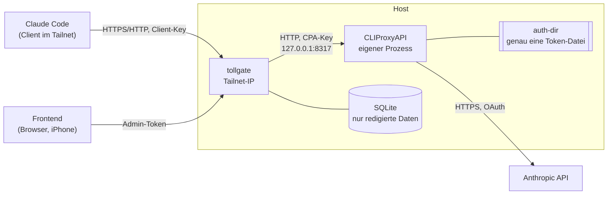

# tollgate – Architektur

Stand: 2026-10-04 · Issue #1 · Entscheidungen im Detail: [`docs/adr/`](adr/README.md)

## 1. Überblick

tollgate ist ein Gateway für alle Claude-API-Aufrufe aus Claude Code. Jede Anfrage läuft durch
eine feste Pipeline: Redaction, Kompression, Messung und Weiterleitung. Jede Stufe ist im
Frontend nachvollziehbar.

Grundprinzip: **Alles passiert im Proxy.** Ein Client setzt nur `ANTHROPIC_BASE_URL` und
seinen Client-Key.



Die Antwort läuft rückwärts durch tollgate. Platzhalter werden dabei zurückübersetzt.

## 2. Komponenten und Pakete

Zielstruktur und Begründung: [ADR-0002](adr/0002-zielstruktur.md). Bibliotheken:
[ADR-0003](adr/0003-bibliotheken.md).

| Paket | Verantwortung |
|---|---|
| `cmd/tollgate` | Start, Bootstrap-Konfiguration laden, Startprüfungen, Verdrahtung |
| `internal/server` | HTTP-Routen: Proxy (`/v1/*`), Admin-API (`/api/*`), Live-Feed (SSE), eingebettetes Frontend |
| `internal/auth` | Client-Keys (Hash, Sperren, Rotation), Admin-Token |
| `internal/pipeline` | `Stage`-Interface, Request-Kontext, Trace-ID, Sitzungsschlüssel, Ausführung und Trace-Erfassung pro Stufe |
| `internal/jsonsplice` | Byte-Offsets von JSON-Strings, Ersetzungslisten, feste Escape-Funktion |
| `internal/redact` | Detektoren, Auflösung von Überlappungen, nummerierte Platzhalter, Rehydrator |
| `internal/compress` | Befehlserkennung, Regeln, Strategien (Headroom-Port) |
| `internal/meter` | Token-Schätzung vorab, `usage`-Erfassung, Kosten |
| `internal/sse` | SSE-Parser und -Writer |
| `internal/upstream` | Client zu CLIProxyAPI und dessen Management-API |
| `internal/config` | Bootstrap- und Laufzeitkonfiguration, Schema, YAML, Versionen, Verschlüsselung |
| `internal/store` | SQLite: Traces, Messwerte, Konfigurationsversionen, Sitzungen, Clients |
| `web/` | Svelte-Frontend, per `embed` im Binary |
| `deploy/cliproxyapi` | CLIProxyAPI-Build gepinnt aus dem Upstream (`ARG CPA_VERSION`), eigenes Binary, keine Kopie im Repo (ADR-0014) |

### Stage-Interface (Skizze)

```go
type Stage interface {
    Name() string
    // Process gets the current body bytes and returns the replacements to apply
    // plus a redacted-only trace record. Must be deterministic (ADR-0004).
    Process(ctx *pipeline.Context, body []byte) (Result, error)
}
```

Die Pipeline wendet die Ersetzungen jeder Stufe an und reicht den neuen Body weiter. Pro
Stufe erfasst sie: Dauer, Bytes und geschätzte Tokens vorher/nachher, SHA-256 von Ein- und
Ausgabe und die Ersetzungsliste als Diff-Grundlage. Alles davon entsteht aus redigierten
Daten (ADR-0009).

## 3. Pipeline-Stufen

| # | Stufe | Eingabe | Ausgabe | Paket | ADR |
|---|---|---|---|---|---|
| 0 | **Eingang** | HTTP-Request von Claude Code | geprüfter Client, Trace-ID, Sitzungsschlüssel, gepinnte Konfigurationsversion, Body als `[]byte`, Pfadindex der Content-Blöcke | `server`, `auth`, `pipeline`, `jsonsplice` | [0006](adr/0006-platzhalter-sitzungen-rueckweg.md), [0009](adr/0009-authentifizierung-und-geheimnisse.md) |
| 1 | **Redact** | Body, Konfigurationsversion | Body mit `<redacted:TYP_N>`, Zuordnung nur im RAM, Trefferliste ohne Werte | `redact` | [0005](adr/0005-redactor-port.md), [0006](adr/0006-platzhalter-sitzungen-rueckweg.md) |
| 2 | **Compress** | redigierter Body, Regeltabelle der Version | Body mit gekürzten Bash-`tool_result`s | `compress` | [0007](adr/0007-kompression-und-headroom-port.md) |
| 3 | **Meter** (vorab) | finaler Body | Token-Schätzung im Trace | `meter` | – |
| 4 | **Forward** | finaler Body, durchgereichte Header | Upstream-Response (SSE oder JSON) | `upstream` | [0001](adr/0001-cliproxyapi-als-eigener-prozess.md) |
| 5 | **Rückweg** | Upstream-Events | Events mit zurückübersetzten Platzhaltern (außer Thinking); `usage` (`input`, `output`, `cache_read`, `cache_creation`) aus `message_start`/`message_delta` an Meter | `redact`, `sse`, `meter` | [0006](adr/0006-platzhalter-sitzungen-rueckweg.md) |

**Endpunkte:**
- `POST /v1/messages`: Stufen 0–5.
- `POST /v1/messages/count_tokens`: Stufen 0–4, kein Rückweg (ADR-0006).
- Alle anderen Pfade unter `/v1/`: nur Eingang (Key-Prüfung) und unverändertes Durchreichen
  über `httputil.ReverseProxy`. Header wie `anthropic-version` und `anthropic-beta` bleiben
  erhalten.

**Fehlerverhalten:** Ist der Body kein gültiges JSON oder schlägt eine Stufe fehl, bricht
tollgate mit einer Fehlerantwort im Anthropic-Format ab, statt ungefiltert weiterzuleiten.
Klartext darf nie versehentlich upstream gehen (ADR-0004, Punkt 7).

## 4. Sitzungsmodell

Details: [ADR-0006](adr/0006-platzhalter-sitzungen-rueckweg.md).

- **Sitzung** = `hex(SHA-256(client_id ‖ 0x00 ‖ session_id))` ([ADR-0011](adr/0011-sitzungsschluessel-trennbyte.md)). `session_id` kommt aus
  `X-Claude-Code-Session-Id`, ersatzweise aus `metadata.user_id`.
- Beim ersten Request pinnt eine Sitzung die aktive **Konfigurationsversion** (DB-Tabelle
  `sessions`, keine Geheimnisse). Neue Regeln gelten erst für neue Sitzungen.
- **Platzhalter-Zuordnung pro Anfrage:**
  - Nummeriert wird nach erstem Auftreten im Request, pro Typ.
  - Der Verlauf wächst nur nach hinten, deshalb ergibt jeder Turn dieselben Platzhalter für
    den Präfix.
  - Die Zuordnung lebt nur im RAM und nur bis zum Ende des Antwort-Streams.
- **Assistant-Text und `tool_use.input` im Verlauf werden erneut redigiert.** So wird der
  Klartext, den der Rückweg eingesetzt hat, wieder zum selben Platzhalter, den das Modell
  erzeugt hat.
- **Thinking** wird in keiner Richtung verändert.

## 5. Netzwerk und Prozesse

Details: [ADR-0001](adr/0001-cliproxyapi-als-eigener-prozess.md),
[ADR-0008](adr/0008-konfigurationsschema.md), [ADR-0009](adr/0009-authentifizierung-und-geheimnisse.md).

| Prozess | Bindung | Spricht mit | Authentifizierung |
|---|---|---|---|
| tollgate | konkrete Tailnet-IP oder Container-Adresse mit veröffentlichter Tailnet-IP (Startprüfung, ADR-0013) | Clients, Browser, CLIProxyAPI | Client-Keys (`/v1/*`), Admin-Token (`/api/*`, Frontend) |
| CLIProxyAPI | `127.0.0.1:8317` | tollgate, Anthropic | `access.api-keys` (ein Key für tollgate), Management-Secret |

- **Zwei Binaries:** `tollgate` aus dem Hauptmodul, `cli-proxy-api` per `go install` aus dem
  gepinnten Upstream-Modul (`make cpa`, ADR-0014).
- **docker-compose:** tollgate und CLIProxyAPI in einem gemeinsamen Netzwerk-Namespace, kein
  Tailscale-Container. Docker veröffentlicht nur `<host-tailnet-ip>:8443` (tollgate) und den
  OAuth-Callback des Login-Dienstes auf `127.0.0.1:54545`. Einstieg `just setup`
  ([ADR-0012](adr/0012-container-deployment-tailscale-sidecar.md),
  [ADR-0013](adr/0013-veroeffentlichung-auf-host-tailnet-ip.md), [DEPLOY.md](DEPLOY.md)).
- **Aktiver Account:** `GET /v8/management/credentials`. Liegt mehr als eine Token-Datei im
  auth-dir, ist das ein Health-Fehler.

## 6. Harte Regeln → Durchsetzung → Test

| Harte Regel (`AGENTS.md`) | ADR | Durchsetzung | Geplanter Test |
|---|---|---|---|
| Niemals Read-, Edit- oder Datei-Inhalte komprimieren, nur Bash-Ausgaben | [0007](adr/0007-kompression-und-headroom-port.md) | Compress verarbeitet nur `tool_result`, deren `tool_use.name == "Bash"` ist | Tabellentest mit Read, Edit, Write, Grep, Glob, MCP: Ausgabe bytegleich (#19) |
| Alle Transformationen deterministisch, Byte für Byte | [0004](adr/0004-json-byte-splicing-und-determinismus.md) | Byte-Splicing, Determinismus-Checkliste, Nummerierung pro Anfrage | Determinismus-Test pro Stufe (100 Läufe, `-race`), Cache-Test über mehrere Turns (#17) |
| Thinking-Blöcke und Signaturen nie verändern | [0004](adr/0004-json-byte-splicing-und-determinismus.md), [0006](adr/0006-platzhalter-sitzungen-rueckweg.md) | gesperrte Blocktypen im Splicing, kein Rehydrate von `thinking_delta`/`signature_delta` | Byte-Treue-Test mit allen gesperrten Blocktypen (#5, #14) |
| Unbekannte Content-Typen und Felder unverändert durchreichen | [0004](adr/0004-json-byte-splicing-und-determinismus.md) | Body nie neu serialisiert, nur Zielstrings ersetzt | Fuzz-Test `jsonsplice`, Fixture mit erfundenen Feldern und Blocktypen (#5) |
| In Logs, DB und Frontend nur redigierte Daten | [0009](adr/0009-authentifizierung-und-geheimnisse.md) | Traces aus der redigierten Fassung, Treffer ohne Werte, `slog`-Maskierung, Abbruch statt ungefiltertem Weiterleiten | Leck-Test über SQLite-Datei, Logs und `/api/*` (#17) |
| tollgate nur an Tailnet-IP, CLIProxyAPI nur an localhost | [0001](adr/0001-cliproxyapi-als-eigener-prozess.md), [0008](adr/0008-konfigurationsschema.md), [0009](adr/0009-authentifizierung-und-geheimnisse.md) | Startprüfung von `listen` und `upstream.url`, `server.host: 127.0.0.1` in der CPA-Vorlage | Unit-Test der Startprüfung (#2/#6), Prüfung der Konfigurationsvorlage (#3) |
| Im auth-dir nur die Token-Datei des aktiven Accounts; Frontend zeigt aktiven Account | [0001](adr/0001-cliproxyapi-als-eigener-prozess.md) | Health-Check über die Management-API, Fehler bei mehr als einer Datei | Integrationstest mit Mock-Management-API (#10) |
| Geheimnis-Zuordnung nur im RAM | [0006](adr/0006-platzhalter-sitzungen-rueckweg.md) | Zuordnung nur für die Dauer des Requests, nie gespeichert | Leck-Test (#17) |
| Neue Regeln nur für neue Sitzungen | [0006](adr/0006-platzhalter-sitzungen-rueckweg.md), [0008](adr/0008-konfigurationsschema.md) | Pinning der Version in `sessions` | Cache-Test mit Konfigurationsänderung mitten in der Sitzung (#17) |
| Wortliste vertraulich: verschlüsselt, maskiert, nie geloggt | [0008](adr/0008-konfigurationsschema.md), [0009](adr/0009-authentifizierung-und-geheimnisse.md) | AES-256-GCM, maskierte Diffs, Export-Warnung | Unit-Tests Verschlüsselung und Maskierung (#15) |

## 7. Abweichungen vom Auftrag (zur Freigabe)

Diese Punkte weichen bewusst vom Wortlaut in `AGENTS.md` ab. Jede Abweichung ist im
verlinkten ADR begründet.

| # | Auftrag sagt | Architektur macht | Grund | ADR |
|---|---|---|---|---|
| 1 | „Nur User-Text und `tool_result` anfassen“ | Assistant-`text` und String-Werte in `tool_use.input` im Verlauf werden ebenfalls redigiert | Der Rückweg setzt Klartext ein, der im nächsten Turn zurückkommt. Ohne erneutes Redigieren ginge er upstream, und der Präfix wiche vom Modell-Output ab | [0006](adr/0006-platzhalter-sitzungen-rueckweg.md) |
| 2 | „Zuordnung im RAM, mit TTL pro Sitzung“ | Zuordnung pro Anfrage, aus der Anfrage abgeleitet, nur bis zum Stream-Ende im RAM. Die Sitzung pinnt nur die Konfigurationsversion | Subagenten teilen sich eine Sitzungs-ID; nach einem Neustart wäre eine gespeicherte Zuordnung weg. Strenger und zustandslos | [0006](adr/0006-platzhalter-sitzungen-rueckweg.md) |
| 3 | „Platzhalter beim Streamen zurückübersetzen“ (ohne Ausnahme) | `thinking_delta` und `signature_delta` werden nicht zurückübersetzt | Die Signatur gilt für die Fassung mit Platzhaltern; die API würde den nächsten Turn ablehnen | [0006](adr/0006-platzhalter-sitzungen-rueckweg.md) |
| 4 | „Andere Endpunkte (z. B. `count_tokens`) unverändert durchreichen“ | `count_tokens` läuft durch Redact und Compress | Sonst gingen Geheimnisse im Klartext upstream, und die Zählung passte nicht zur gesendeten Fassung | [0006](adr/0006-platzhalter-sitzungen-rueckweg.md) |
| 5 | Parität zum Rust-Redactor | `connection_urls` erkennt nur URLs mit Passwort und ersetzt nur das Passwort | Auftrag nennt „Verbindungs-URLs mit Passwort“. Host und Datenbank bleiben für das Modell lesbar | [0005](adr/0005-redactor-port.md) |
| 6 | Parität zum Rust-Redactor | Erst alle Treffer sammeln, dann Überlappungen auflösen, statt sequenzieller Ersetzung | Rust verliert Labels (`api_key=sk-ant-…` → `<redacted>`) und matcht eigene Platzhalter erneut | [0005](adr/0005-redactor-port.md) |
| 7 | „CLIProxyAPI als Kopie unter `third_party/cliproxyapi`“ | Kopie bleibt, aber als eigenständiges Go-Modul, eigenes Binary, nie importiert | Das Claude-Verhalten liegt in `internal/`, das SDK ist instabil und schwer. Ein eigener Prozess hält Updates einfach. Die Kopie entfiel später zugunsten eines gepinnten Builds | [0001](adr/0001-cliproxyapi-als-eigener-prozess.md), [0014](adr/0014-cliproxyapi-gepinnt-ohne-kopie.md) |
## 8. Auswirkungen auf Folge-Issues

| Issue | Anpassung |
|---|---|
| #2 Repo-Scaffold | Zusätzliche Pakete `jsonsplice`, `sse`, `auth` sowie `deploy/` und `third_party/headroom/` anlegen; `tygo` als `go tool`; Platzhalter für `web/dist` (ADR-0002, ADR-0003) |
| #3 CLIProxyAPI einbinden | Kopie als eigenständiges Modul mit `CGO_ENABLED=0`-Build, Pflichtkonfiguration als Vorlage unter `deploy/cliproxyapi/`, kein veröffentlichter Port (ADR-0001) |
| #4 Store | Tabellen `config_versions`, `sessions`, `clients`, Traces ohne Klartext; eigener Migrations-Runner (ADR-0003, ADR-0006, ADR-0008, ADR-0009) |
| #5 Pipeline-Kern | `Stage` mit Ersetzungslisten, `jsonsplice` mit Fuzz-Test, Sitzungsschlüssel; Quelle der Sitzungs-ID an einer aufgezeichneten Anfrage verifizieren (ADR-0004, ADR-0006) |
| #6 Proxy | Header-Regeln (durchreichen, ersetzen, `Accept-Encoding: identity`), Startprüfung der Bindung, Abbruch statt ungefiltertem Weiterleiten (ADR-0001, ADR-0006, ADR-0008) |
| #7 Meter | `usage` aus `message_start`/`message_delta`; Schätzheuristik festlegen (ARCHITECTURE §3) |
| #8 Client-Keys | Format `tg_…`, SHA-256-Speicherung, Anthropic-Fehlerformat (ADR-0009) |
| #9 Frontend-Grundgerüst | Svelte 5, eigener Hash-Router, CodeMirror 6, eigene CSS-Tokens, pnpm (ADR-0003) |
| #10 Frontend Phase 1 | Aktiver Account über die Management-API, Warnung bei abweichender CPA-Baseline (ADR-0001) |
| #11 Phase-1-Abnahme | `docs/CLIENT_SETUP.md` inkl. Hinweis auf Platzhalter im Thinking; Docker-Topologie für die Tailnet-Bindung entscheiden |
| #12 Redactor-Port | Schalter-Zuordnung, txtar-Korpus, Paritätstest mit Normalisierung und Liste bewusster Abweichungen (ADR-0005) |
| #13 Redact-Stage | Nummerierung pro Anfrage, Blocktabelle inkl. Assistant-Blöcke, `count_tokens`, Sitzungs-Pinning; Spike zum `cc_version`-Fingerprint (ADR-0006) |
| #14 Rückweg | Puffer pro Content-Block, kein Rehydrate von Thinking, JSON-Escaping in `input_json_delta`, Nicht-Streaming-Antworten (ADR-0006) |
| #15 Redactor-Konfiguration | Zwei Ebenen, Schema mit `additionalProperties: false`, Abschnitt `compress:`, Rollback als neue Version, AES-256-GCM (ADR-0008, ADR-0009) |
| #16 Frontend Phase 2 | Live-Validierung gegen das ausgelieferte Schema, Dry-Run-Vorschau, Diff aus Ersetzungslisten (ADR-0004, ADR-0008) |
| #17 Phase-2-Abnahme | Cache-Test mit Rückübersetzung und erneuter Redaktion, Leck-Test über DB, Logs und API (ADR-0006, ADR-0009) |
| #18 Token-Analyse | unverändert; liefert die Rangliste für #19 und entscheidet über `search` |
| #19 Compress-Stage | zustandslos über den ganzen Verlauf, Befehlsnormalisierung, Gates, Kennzeichnungszeile (ADR-0007) |
| #20 Headroom-Port | Strategien 1–5 (6 optional) mit festen Obergrenzen, `third_party/headroom/` mit LICENSE und NOTICE (ADR-0007) |
| #21 Playground | Schritte der Strategien sichtbar machen (ADR-0007) |
| #22–#25 | keine Anpassung nötig |

## Account-Verwaltung (#28)

[ADR-0015](adr/0015-account-tresor-und-wechsel.md) ergänzt die Ein-Account-Regel: Mehrere
Abos liegen verschlüsselt in SQLite (`accounts`), aber CLIProxyAPI enthält weiter nur die
aktive Datei. `internal/accounts` koordiniert PKCE-Login, Import, Tresor und manuellen
Wechsel. `internal/cryptobox` stellt AES-256-GCM mit Record-ID als AAD bereit; der persistente
Schlüssel wird über `crypto.key_file` konfiguriert. Die Account-API ist ausschließlich im
Admin-Zweig von `/api/accounts` erreichbar. `internal/server` hält eine gemeinsame Sperre
über die vollständige Proxy-/Stream-Laufzeit. Vor dem Wechsel werden rotierte Tokens
zurückgesichert, danach Delete/Upload/Verifikation; Fehler lösen Rücksicherung aus.
Das Frontend zeigt Login-URL, Callback-Eingabe, Aktivieren mit Cache-Hinweis und das
Ergebnis eines kurzen Beispielaufrufs. Lizenzplan und nicht belegte Statuswerte werden
nicht geraten; der breitere Ausbau bleibt #29.

## Performance (#87, #116)

**Messwerte pro Trace.** `ttft_us` ist die Zeit vom Eingang bis zum ersten Inhalt beim
Client: bei SSE nach dem Flush des ersten `content_block_delta`, bei JSON beim Eintreffen
der Upstream-Header. Bei Status ≥ 400, Abbruch, `count_tokens` und Passthrough bleibt der
Wert `NULL`. Der Eigenanteil `tollgate_us` ist die Summe der Stufen plus Rückweg
(`return_us`, `return_replacements`). Tokens/s = Ausgabe-Tokens / (Dauer − `gen_start_us`),
nur bei Streams. `gen_start_us` ist der Flush von `message_start` (Migration 0008). Die
TTFT taugt nicht als Basis, denn bei verdecktem Thinking kommt das erste
`content_block_delta` erst nach allen Thinking-Tokens, die trotzdem als Ausgabe zählen.
Ältere Traces ohne `gen_start_us` haben keinen Tokens/s-Wert.

**Erwartungswert (`internal/perf`).** Vergleichswerte sind erfolgreiche `messages`-Traces
desselben Modells aus den letzten 14 Tagen (höchstens 500, ohne Speedtest). Klassen:
Eingabe `i0`–`i3` (Grenzen 8k/32k/128k), Ausgabe `o0`–`o3` (256/1024/4096). TTFT wird nach
Eingabe-Klasse verglichen, die Dauer nach `i×o` mit Rückfall auf `o`. Perzentile nach
Nearest-Rank. „langsam“ erst ab 20 Vergleichswerten und nur, wenn der Wert über p90 liegt,
mindestens 1,5 × Median beträgt und mindestens 1 s über dem Median liegt. Das Urteil
landet in `trace_perf`.

**Tokens/s-Urteil (#116).** `tps_milli` ist ganzzahlig. Verglichen wird nach Modell ×
Eingabe-Klasse mit Rückfall auf alle Eingaben (`*`), nur Streams mit mindestens 64
Ausgabe-Tokens. Unter p10 und mindestens 20 % unter dem Median heißt „langsamer“, über
p90 und mindestens 20 % darüber „schneller“, sonst „üblich“ (ab 20 Vergleichswerten, darunter „unbekannt“). Gespeichert in `trace_tps`.
Die Urteile laufen nach `FinishTrace` und vor dem Live-Event. Ein Store-Fehler wird nur
geloggt und blockiert die Anfrage nie.

**Einfluss-Matrix.** `/api/performance` gruppiert je Modell nach Eingabe-Klasse ×
Cache-Anteil (`c0` < 50 %, `c1` 50–89 %, `c2` ≥ 90 % `cache_read` an der Eingabe). Das
ergibt 12 Zellen mit Medianen für TTFT, Dauer und Tokens/s ab 5 Werten. Daraus entstehen
die Kernaussagen „Cache senkt TTFT“ und „Eingabe senkt Tokens/s“, dazu Trendfelder je Tag.

**Speedtest.** `POST /api/speedtest` braucht `confirm: true`, weil er Abo-Kontingent
verbraucht. Er erlaubt 1–4 Modelle und läuft nie parallel (sonst 409). `server.Probe`
schickt eine feste Anfrage über denselben Pfad wie ein Client. Die Identität ist der
reservierte, gesperrte Client `speedtest`; sie wird nur im Prozess über den Kontext
gesetzt (`pipeline.WithInternalClient`) und ist per Header nicht erreichbar. Je Modell
läuft ein Durchgang ohne und einer mit Redact-Stufe; nur `redact` ist überspringbar.
Speedtest-Traces fließen nicht in die Vergleichswerte ein. CLI: `just speedtest <modelle>`.

## Kosten & Performance (#121)

**Eine Seite.** Kosten und Performance teilen sich den Bereich `#/costs` (Taste `3`);
`#/performance` leitet per `history.replaceState` dorthin um. Oben stehen Gesamtkosten je
Account, die Kostenkurve, eine Kennzahlenzeile und das Tokens/s-Diagramm, darunter die
Aufschlüsselung (Account / Modell / Client / Tag) und die Performance-Details. Account-Namen
kommen aus `/api/accounts`, sonst `Account <ID 12>`.

**Kostenbericht.** `GET /api/costs` liefert je Zeile zusätzlich `cache_savings_nano_usd` =
`cache_read · (Eingabe − Cache-Lesen)` nach Listenpreis (`meter.CacheSavings`, `null` ohne
Preis). Für die letzten min(N, 8) Tage kommt `hours` dazu: je UTC-Stunde × Account × Modell
Anzahl, Usage und Kosten (`store.CostByHour`); das Modell bleibt in der Zeile, damit
unbekannte Preise wie bei den Tagen `null` bleiben. Leere Stunden fehlen. `GET
/api/performance` liefert je Modell `hours` mit dem Median Tokens/s je Stunde (gleiches
Fenster). Beide Diagramme nutzen `hourAxis` (`web/src/lib/hours.ts`): von der ersten Stunde
mit Daten bis zur aktuellen Stunde, höchstens 168 Stunden. Wenige Stunden Daten ergeben also
eine kurze Achse.

## Limit-Alarm (#122)

`internal/alert` beobachtet die Limits jeder Antwort über `accounts.Manager.OnLimits` und den
Endstatus jeder Anfrage als Abonnent des Trace-Brokers. Ab `alerts.five_hour_threshold`
(Default 90) entsteht je Abo und 5-Stunden-Fenster eine Warnung je höherem vollem
Prozentpunkt. CLIProxyAPI reicht bei einer Anthropic-429 die Limit-Header nicht weiter.
Deshalb gilt eine 429 als Ablehnung, wenn das Abo zuletzt an der Schwelle lag oder abgelehnt
war. Dann wechselt ein einzelner Worker asynchron per `Activate` auf den besten Kandidaten:
nicht aktiv, Woche und 5 Stunden unter 100 % oder unbekannt, keine neue Anmeldung nötig.
Zwischen zwei Versuchen liegen mindestens 10 Minuten. Nachrichten landen atomar als Dateien
im Spool (`alerts.spool_dir`). Der Dienst `notifier` (`tollgate notify`) sendet sie außerhalb
des Anthropic-only-Namespace an Slack ([ADR-0019](adr/0019-alarme-spool-notifier.md)).

## Kompression (#18–#20)

**Auswahl.** Die Regeln folgen der Token-Analyse ([token-analyse.md](token-analyse.md)).
Dateilesen per Bash (`cat`, `sed -n`, `head`, `tail`) bekommt keine Regel, weil die
Ausgabe Dateiinhalt ist. `find` bleibt ebenfalls ohne Regel, weil `-exec` beliebige
Inhalte ausgeben kann.

**Ablauf (`internal/compress`).** Die Stufe läuft nach Redact und nur, wenn
`TOLLGATE_COMPRESS_ENABLED` gesetzt ist. Sie sammelt aus den `jsonsplice`-Targets die
Bash-`tool_use`s (`tool_id` → `input.command`). Danach kürzt sie jedes `tool_result` mit
passender `tool_use_id`, und zwar über den ganzen Verlauf und zustandslos (ADR-0007).
`Normalize` reduziert den Befehl auf den einen Befehl, der die Ausgabe erzeugt. Pipes,
`||`, `$(…)`, Heredocs und Ketten mit mehr als einem Befehl bleiben unverändert.
Konfigurierte Regeln der gepinnten Version kommen vor den eingebauten. Gates:
`min_bytes` (2048) und ein strikt kleineres Ergebnis samt Kennzeichnungszeile.

**Strategien.** Jede Strategie ist eine reine Funktion
`func(out string, p strat.Params, t strat.Trace) strat.Result` in einem eigenen Paket. Die
Golden-Files liegen unter `testdata/<strategie>/`.

| Strategie | Paket | Befehle (eingebaute Regeln) |
|---|---|---|
| `test_log` | `compress/logs` | `go test`, `cargo test`, `pytest`, `pnpm test`/`vitest`/`jest`, `make test`, `just test` |
| `build_log` | `compress/logs` | `pnpm install`/`npm install`/…, `go build`, `cargo build`, `docker build`, `uv sync`, `make` |
| `diff` | `compress/diff` | `git diff`, `git show`, `git log -p`, `git stash show -p` |
| `search` | `compress/search` | `grep`, `egrep`, `fgrep`, `rg`, `git grep` |
| `passthrough` | `compress` | schaltet einen Befehl per Konfiguration ab |

Wenn eine Strategie Zeilen auslässt, setzt sie an dieser Stelle eine kurze Notiz (z. B.
`[tollgate: 1 Hunk ausgelassen (Lockfile, 244 Zeilen)]` oder
`… src/x.go: 14 weitere Treffer`). Behaltene Zeilen bleiben byte-gleich. Herkunft der
portierten Teile: [`third_party/NOTICE.md`](../third_party/NOTICE.md).
